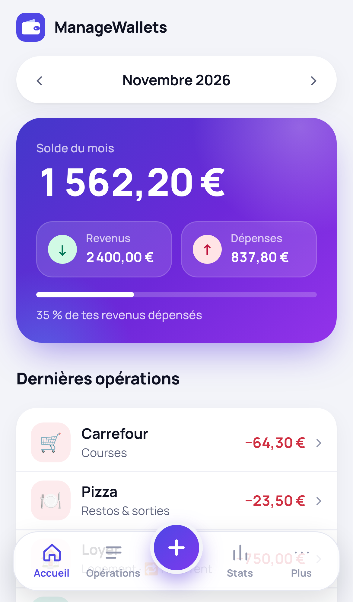
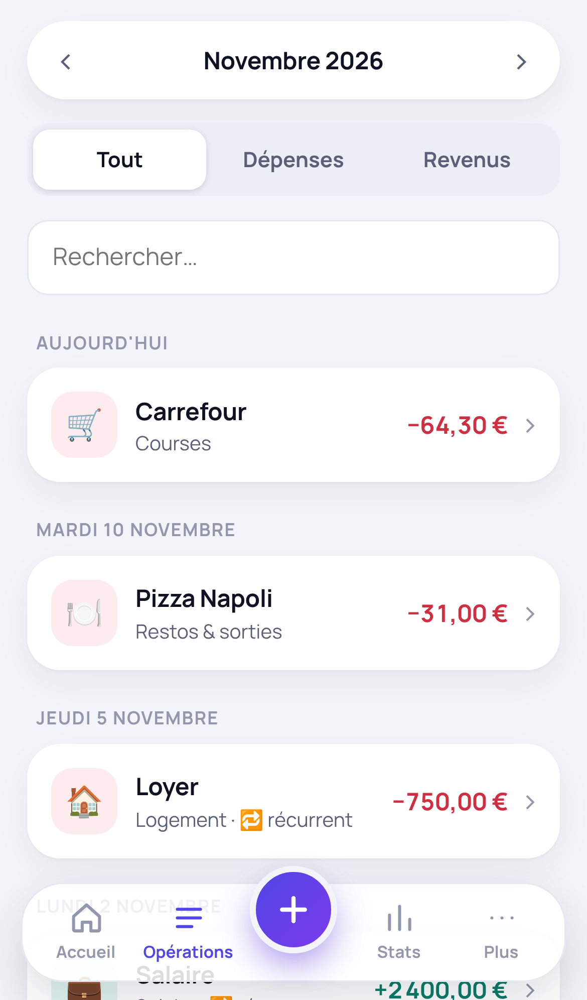
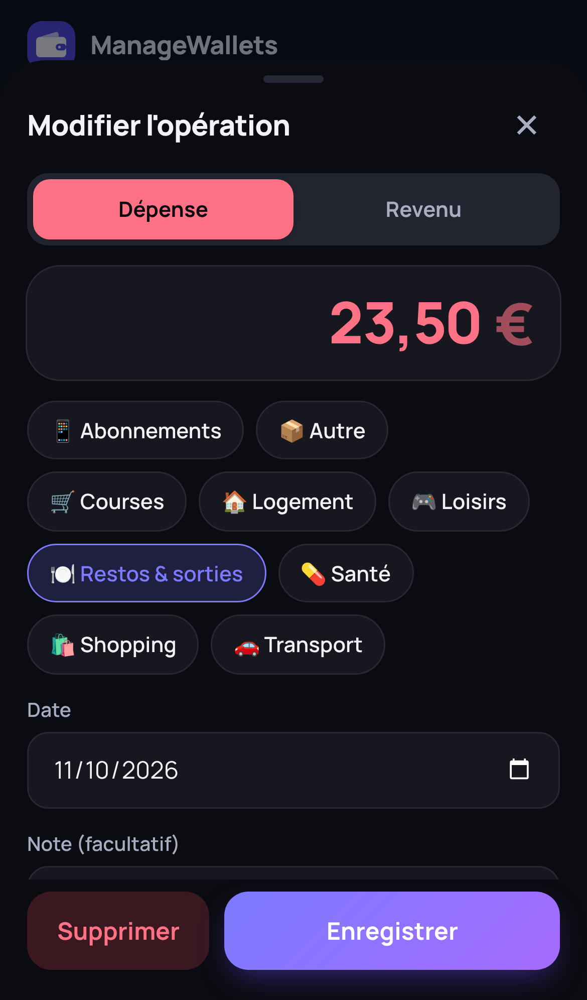
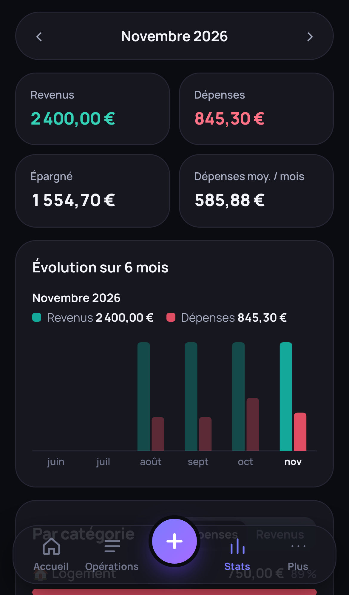

<div align="center">


# ManageWallets

**A fast, private, installable budget tracker for your phone.**

Log income and expenses in seconds, automate recurring payments, and see where your money goes, all stored on your device, with no account and no server.

[**Live demo**](https://nathan-part.github.io/ManageWallets/) · [Features](#features) · [Tech stack](#tech-stack) · [Getting started](#getting-started)


</div>

<p align="center">
  
  
  
  
</p>

## Features

- **Quick entry**: one tap on **+**, type an amount, pick a category, done.
- **Edit anything**: tap any transaction, recurring rule or category to change or delete it.
- **Recurring transactions**: salary, rent and subscriptions are added automatically every month. Rules can be paused and resumed, and a day like the 31st falls back to the last day of shorter months.
- **Statistics**: monthly balance, a 6-month income vs. expenses chart, and a breakdown by category.
- **Clear colour coding**: expenses in red, income in green, everywhere.
- **Multi-currency display**: Euro (€) or Israeli Shekel (₪).
- **Custom categories** with emoji icons.
- **Backup and restore** to a JSON file, so you can move to a new phone.
- **Works offline** and installs to the home screen like a native app.
- **Light and dark themes** that follow the system setting.

> The interface is in French.

## Privacy by design

ManageWallets is **local-first**. All data lives in the browser's IndexedDB on your device. Nothing is ever sent to a server, there is no account, no tracking and no analytics. The app also asks the browser for persistent storage so your data is not evicted.

Because nothing is synced, export a backup from time to time (**Plus → Sauvegarde → Exporter**).

## Tech stack

| Area | Choice |
| --- | --- |
| UI | React 19, TypeScript (strict) |
| Build | Vite 8 |
| Storage | IndexedDB via Dexie, with live queries (`dexie-react-hooks`) |
| PWA | `vite-plugin-pwa` (Workbox service worker, web manifest, auto-update) |
| Charts | Hand-written SVG, no chart library |
| Styling | Plain CSS with design tokens, Manrope variable font |
| Tests | Vitest |
| CI/CD | GitHub Actions → GitHub Pages |

### Implementation notes

- **Money as integers**: amounts are stored in cents to avoid floating-point rounding errors, and formatted with `Intl.NumberFormat`.
- **Timezone-safe dates**: dates are handled as local `YYYY-MM-DD` strings, so a transaction never shifts to another day.
- **Idempotent recurring engine**: each rule remembers the last date it generated. On launch and whenever the app returns to the foreground, it creates only the missing occurrences, so there are never duplicates, even after days offline.
- **Accessible charts**: the chart colours were checked for colour-blind safety and contrast, and every value is also shown as text.
- **Small bundle**: about 110 kB gzipped, with no UI framework or chart library.

## Getting started

Requires Node.js 20 or newer.

```bash
git clone https://github.com/Nathan-Part/ManageWallets.git
cd ManageWallets
npm install
npm run dev
```

| Script | Description |
| --- | --- |
| `npm run dev` | Start the development server |
| `npm test` | Run the unit tests |
| `npm run build` | Type-check and build for production into `dist/` |
| `npm run preview` | Serve the production build locally |

## Deployment

The app is a fully static site, so it can be hosted for free anywhere.

**GitHub Pages (preconfigured)**: in the repository settings, go to **Pages** and set **Source** to **GitHub Actions**. Every push to `main` then runs `.github/workflows/deploy.yml`, which tests, builds and publishes the site.

**Vercel, Netlify or Cloudflare Pages**: import the repository, use `npm run build` as the build command and `dist` as the output directory.

## Install on your phone

Open the live site, then:

- **iPhone (Safari)**: Share → **Add to Home Screen**
- **Android (Chrome)**: menu ⋮ → **Install app**

## Project structure

```
src/
├── App.tsx              # App shell, tab navigation, recurring sync
├── db.ts                # Dexie schema, default categories, backup/restore
├── hooks.ts             # Live-query hooks and totals
├── lib/
│   ├── money.ts         # Cents parsing/formatting, currency setting
│   ├── dates.ts         # Timezone-safe date helpers
│   ├── recurring.ts     # Pure scheduling logic for recurring rules
│   └── lib.test.ts      # Unit tests
├── components/          # Bottom sheet, entry form, lists, charts
└── pages/               # Home, Transactions, Stats, More
```
